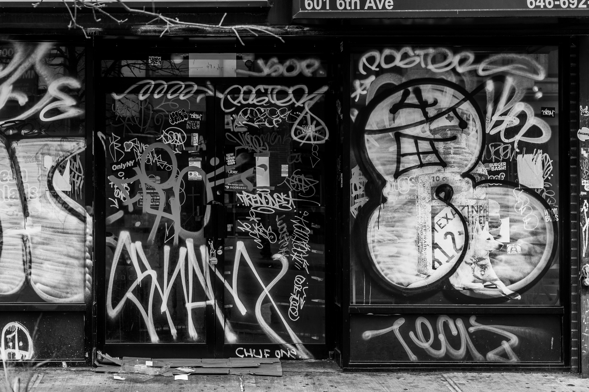
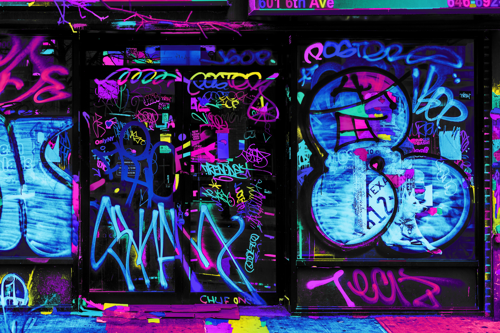

#  Neon Graffiti Colorizer

Turns grayscale and black-and-white images into neon graffiti art, pixel by pixel. No AI, just image processing. Black linework is never touched, and the output keeps the exact resolution of the input.

##  Before / After

| Before | After |
|:---:|:---:|
|  |  |
|  |  |

##  Colors


##  Quick Start

```bash
pip install numpy pillow scipy
python neon_graffiti_colorizer.py input.jpg
```

The result is saved as `input_neon.png`.

| Option | Effect |
|---|---|
| `-o out.png` | Custom output name |
| `--seed 42` | Different color layout |
| `--black 20` | Color more of the dark areas |
| `--gradient 0` | Flat fills, no fades |
| `--bg none` | Color the background neon too |

##  How It Works

1.  **Detect outlines:** near-black pixels, adaptive dark strokes, and Sobel edges.
2.  **Close gaps:** broken outlines are sealed so color can't leak.
3.  **Find shapes:** connected-component labelling splits the image into regions.
4.  **Assign colors:** graph coloring ensures neighboring shapes never share a color.
5.  **Paint:** solid fills with subtle fades; textured areas get neon gradient maps.
6.  **Protect black:** near-black pixels are copied from the original unchanged.
