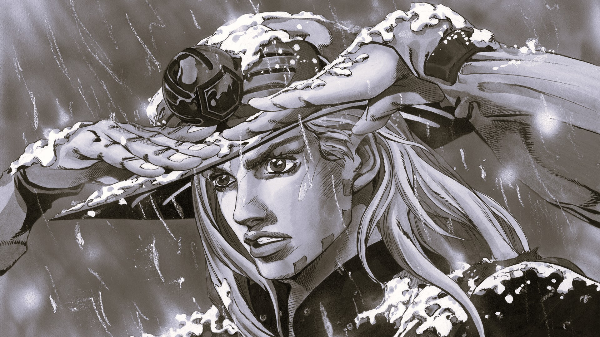
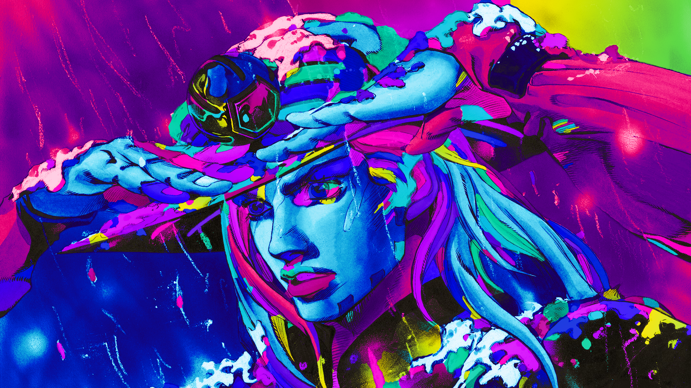

#  Neon Graffiti

Turns grayscale and black-and-white images into deep neon street-art paintings using classic image processing. No AI, no trained models. Black linework is preserved, and the output retains the original image dimensions.

Upload an image, customize the available settings, and compare the original and neon-colored result with an interactive before-and-after slider.

##  Before / After

| Before | After |
|:---:|:---:|
|  |  |

##  Colors

##  How It Works

1.  **Detect outlines:** Identifies dark linework and image edges using classic image-processing techniques.
2.  **Close gaps:** Seals small gaps in outlines to reduce color leakage.
3.  **Find shapes:** Uses connected-component labeling to identify separate image regions.
4.  **Assign colors:** Distributes neon colors across regions for a varied composition.
5.  **Paint:** Applies color fills and gradients to create the neon street-art effect.
6.  **Protect black:** Preserves dark linework to maintain the original illustration's definition.

##  Spray Defender

A retro arcade shooter built into the website, featuring marching enemy formations, diving enemies, destructible bunkers, power-ups, boss encounters, synthesized chiptune audio, and browser-saved high scores.

Play using the keyboard, on-screen touch controls, or a compatible gamepad.

##  Tech Stack

- **Python:** Image-processing backend and utilities.
- **NumPy, SciPy, Pillow:** Pixel manipulation and image processing.
- **JavaScript, HTML, CSS:** Website interface and interactions.
- **Swiper:** Hero carousel.
- **img-comparison-slider:** Before-and-after comparison.
- **Canvas API and Web Audio API:** Arcade game rendering and audio.
